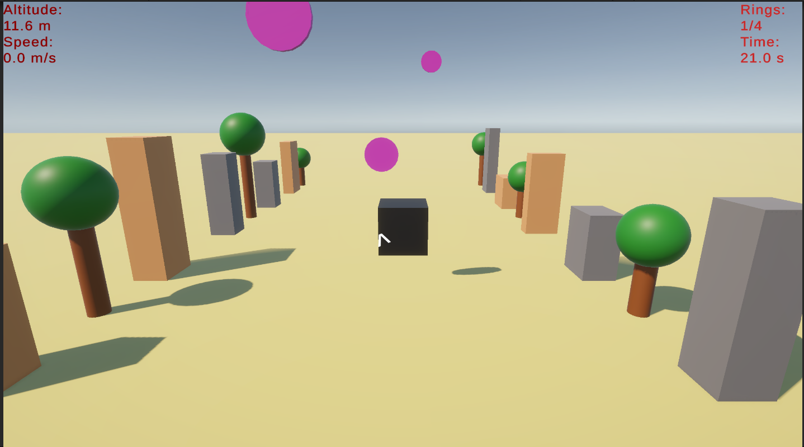

# Drone Simulator

A 3D drone flight training simulator built with **Unity 6.6** and **C#**.
The player flies a drone through a series of rings as fast as possible, with a guidance arrow, live HUD ,and a final score.

## Features
- Drone flight control (movement, climb/descend, yaw)
- Smooth follow camera
- Live HUD: altitude and speed
- Training mission: pass the rings in order, with timer and score
- On-screen guidance arrow pointing to the next ring
- Mission-complete screen and restart with R

## Controls
| Key | Action |
|-----|--------|
| W / A / S / D (or arrows) | Move |
| Space / Left Shift | Ascend / Descend |
| Q / E | Rotate left / right |
| R | Restart |

## How to run
1. Install Unity 6 (6000.3 LTS or newer).
2. Open the project folder in Unity Hub.
3. Open `Assets/Scenes/SampleScene` and press Play.

## What I learned
- Unity scripting with C# (MonoBehaviour, Input System, triggers)
- 3D transforms and vector math
- Building a simple training-mission flow

